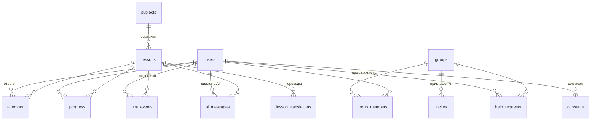

# База данных (Supabase)

Владелец зоны: @Ehai1911 · ревью: @svlab27-web
Статус: миграции 001, 002 и 003 применены в Supabase-проекте `college-tutor` · 13.10.2026

## Коротко

- Одна база **Postgres в Supabase**, схема `public`.
- **Браузер в базу не ходит.** Mini App и кабинет обращаются только к `api/` (Vercel Functions), а `api/` ходит в базу ключом `service_role`.
- **RLS включён на всех таблицах, политик нет** → для ключей `anon` / `authenticated` всё закрыто. Права проверяет `api/`.
- **Схема меняется только миграциями** из `supabase/migrations/`, через PR.
- **Эталоны ответов, тесты и решения** лежат в базе, но `api/` их никогда не отдаёт в браузер.

## 1. Настройка проекта (один раз)

1. supabase.com → New project
   - Name: `college-tutor`
   - Region: **Central EU (Frankfurt)** или **South Asia (Mumbai)** — ближе к Казахстану
   - Пароль базы — сразу в менеджер паролей, в чат и в код не пишем
2. Пригласить второго участника: Organization → Team → Invite.
3. SQL Editor → выполнить по порядку все файлы из `supabase/migrations/` (см. раздел 6):
   - `001_init.sql`
   - `002_fio_consents_ai.sql`
   - `003_lesson_languages.sql`
   - (только dev) `supabase/seed.sql`
   - `NOTIFY pgrst, 'reload schema';` — иначе API Supabase не видит новые таблицы
4. Project Settings → API:
   - **Project URL** → `SUPABASE_URL`
   - вкладка *Legacy API keys* → **`service_role`** (`eyJ…`) → `SUPABASE_SERVICE_ROLE_KEY`
     (новый ключ `sb_secret_…` с supabase-js как Bearer не работает)
5. Ключи вписать **только** в Vercel → Settings → Environment Variables (Production + Preview).
6. Проверка: `select count(*) from subjects;` → 2.

## 2. Модель данных

| Таблица | Что хранит | Ключевые поля |
|---|---|---|
| `subjects` | Предметы пилота | `id` = `python` / `math` |
| `lessons` | Урок целиком из `content/*.json` на основном языке | `subject_id`, `slug`, `version`, `language` (003, по умолчанию `ru`), `content` (jsonb), `is_published`, `approved_by` |
| `lesson_translations` | Урок на другом языке — из `*.kk.json` (003) | `(lesson_id, language)`, `content` (jsonb), `status` = `draft` / `review` / `approved`, `approved_by` |
| `groups` | Учебные группы | `title`, `language` (`ru` / `kk`) |
| `users` | Студенты и преподаватели; куратор создаёт заранее, Telegram привязывается при первом входе (004) | `telegram_user_id` (уникальный, пусто до первого входа), `role`, `full_name` + `full_name_source`, `birth_date` (004, если колледж даёт) / `birth_year`, `delete_after`, `ui_language` (003), настройки напоминаний |
| `group_members` | Кто в какой группе и в какой роли | `(group_id, user_id)`, `role` = `student` / `teacher`, `invite_token` — по какой ссылке вступил (004) |
| `invites` | Личная одноразовая ссылка студента или преподавателя (004) | `token` = `start_param`, `user_id` — чья ссылка, `group_id`, `role`, `expires_at`, `revoked_at`, `created_by`, `used_by` / `used_at` |
| `attempts` | Каждый ответ студента | `answer` (jsonb), `is_correct`, `hints_used`, `is_independent`, `request_id`, `language` (003) |
| `progress` | Где студент в уроке | `(user_id, lesson_id)`, `current_step`, `completed_steps`, `completed_at` |
| `hint_events` | Каждая взятая подсказка | `level` 1–3, `source` = `script` / `ai` |
| `help_requests` | Обращения «нужна помощь» | `text`, `status` = `new` / `resolved` |
| `consents` | Согласия на обработку ПД и родительские (002, 005) | `kind`, `doc_version`, `granted_via` (`telegram` — сам студент; `paper` / `college_list` — согласие родителя, отмечает куратор), `parent_name`, `document_ref` — где бумага, `telegram_user_id` (след после удаления студента; у согласия родителя может быть пусто), `revoked_at` |
| `ai_messages` | Журнал AI-тьютора (002) | `question`, `answer`, `material_ref`, `status`, токены и `cost_usd`, `review_verdict` преподавателя, `language` (003) |

## 3. Основные сценарии

### Вход студента (#5)
1. Куратор один раз вносит группу (лучше списком колледжа): студенты в `users` без `telegram_user_id` — ФИО (`full_name_source = 'roster'`), год рождения — и `group_members`.
2. На каждого студента — **личная одноразовая ссылка** (`invites.user_id`), выдаётся лично: «Скопировать» или QR в кабинете. Общей ссылки группы для реальных студентов нет (решение 14.10.2026).
3. Студент открывает `t.me/tutornvl_bot?startapp=<token>`. `api/` проверяет подпись `initData` (HMAC по `BOT_TOKEN`) и свежесть `auth_date`.
   **Никогда** не доверяем `initDataUnsafe` и `username`.
4. В одной транзакции: ссылка не отозвана, не истекла, не использована → `users.telegram_user_id` = Telegram студента, ссылка помечена использованной. Подробно — в шапке `004_personal_invites.sql`.
   Повторное открытие своей ссылки просто открывает приложение. Ссылка утекла — куратор отзывает её и выдаёт новую.
5. ФИО и год рождения студент не вводит и не меняет — ошибку исправляет куратор («сообщить об ошибке»). Согласие на обработку ПД (`consents`) студент даёт сам. **Младше 18** без отметки куратора о согласии родителя — только демо без сохранения прогресса.

Telegram без личной ссылки → демо, в базу ничего не пишем. Преподавателя так же приглашает администратор колледжа — личной ссылкой со сроком.

### Выдача урока (#6)
- `api/` берёт `lessons.content` и **вырезает** поля `expected`, `tests`, `solution`, `common_mistakes` перед отправкой в браузер.
- Отдаются только уроки с `is_published = true`.

### Ответ студента (#6)
1. Браузер шлёт ответ + `request_id` (uuid, генерирует клиент).
2. `api/` сверяет с эталоном на сервере:
   - `choice` — индекс
   - `number` — `|ответ − value| ≤ tolerance`
   - `formula` — сравнение выражений (#8)
   - `code` — скрытые тесты (#7)
3. Пишет `attempts`. Повтор с тем же `request_id` не создаёт дубль (`unique (user_id, request_id)`).
4. Обновляет `progress`.

### Подсказка
- Каждая подсказка → строка в `hint_events`.
- В самостоятельной задаче (`independent: true`) `api/` подсказки не выдаёт.

### Кабинет преподавателя (#9)
- Преподаватель видит только группы, где он `group_members.role = 'teacher'`.
- «Кто застрял»: 2 неверные попытки подряд по одному шагу **или** ≥ 3 подсказки на шаг.

## 4. Права доступа

| Кто | Что видит | Где проверяется |
|---|---|---|
| Студент | Только свои `attempts`, `progress`, `hint_events`, `help_requests` | `api/`: `user_id` из проверенного `initData` |
| Преподаватель | Студентов своих групп | `api/`: join через `group_members` с ролью `teacher` |
| Админ | Всё | `users.role = 'admin'` |
| Браузер напрямую | Ничего | RLS без политик |

`service_role` обходит RLS, поэтому **любой запрос в `api/` обязан фильтровать по пользователю**. Это пункт ревью для каждого PR в `api/`.

## 5. Уроки: из `content/` в базу

- Источник правды — JSON-файлы в `content/` (правятся через PR).
- После merge скрипт синхронизации делает upsert в `lessons` по `(subject_id, slug, version)`.
- Существенно изменили урок, а по нему уже есть попытки → поднимаем `version`, чтобы старые ответы ссылались на старую версию.
- `is_published` и `approved_by` ставим, когда преподаватель утвердил урок (`status: "approved"` в JSON).
- **Казахский (003, #15):** `NN-тема.kk.json` с тем же `slug` → `lesson_translations` для той же записи урока. Перевод принимается, только если структура совпадает с основным файлом; что должно совпадать и что переводится — в шапке `supabase/migrations/003_lesson_languages.sql`.
- Язык интерфейса студента: `users.ui_language` → если пусто, `language_code` из Telegram → `groups.language`. Нет перевода урока — показываем основной язык.

Скрипт синхронизации — отдельная задача (добавить в бэклог).

## 6. Миграции

- Имя: `NNN_кратко.sql` — следующая свободная: `006_teacher_indexes.sql`.
- **Применённую миграцию не меняем** — только новая сверху.
- Применяем: SQL Editor в Supabase → затем `NOTIFY pgrst, 'reload schema';`.
  Позже можно перейти на Supabase CLI (`supabase db push`).
- В описании PR пишем, применена ли миграция и в каком окружении.
- `seed.sql` — только для dev.

### Журнал применения

Новая строка — в том же PR, что и миграция; дату и окружение дописываем после применения.

| Миграция | Что делает | PR | Применена |
|---|---|---|---|
| `001_init.sql` | 10 базовых таблиц, RLS, предметы `python` / `math` | — (каркас) | 13.10.2026 · `college-tutor` |
| `002_fio_consents_ai.sql` | ФИО и срок хранения в `users`, `invites.full_name`, таблицы `consents` и `ai_messages` | #12 | 13.10.2026 · `college-tutor` |
| `003_lesson_languages.sql` | Уроки на двух языках: `lessons.language`, таблица `lesson_translations`, `users.ui_language`, `attempts.language`, `ai_messages.language` | #21 | 13.10.2026 · `college-tutor` |
| `004_personal_invites.sql` | Личная одноразовая ссылка: `invites.user_id` / `revoked_at` / `created_by`, формат токена, одна действующая ссылка на студента, `group_members.invite_token`, `users.birth_date`; ссылка преподавателя — только со сроком; `invites.full_name` удалён | #35 | — |
| `005_parental_consent.sql` | Согласие родителя отмечает куратор: `consents.document_ref`, `recorded_by` обязателен (куратора не удалить), способ `college_list`, без Telegram студента; при удалении студента отметки о согласии родителя удаляются; одно действующее согласие студента на версию текста | #36 | — |

`seed.sql` в `college-tutor` не применялся.

Перед применением новую миграцию прогоняем в SQL Editor внутри `begin; … rollback;` — проверка на реальной схеме без изменений в базе.

## 7. Окружения и бэкапы

| | Сейчас (пилот) | Позже |
|---|---|---|
| Проекты | Один (dev = prod) | Два: `college-tutor-dev` и `college-tutor` |
| Тариф | Free: 500 МБ, проект засыпает после ~7 дней простоя | Pro ($25/мес), когда пойдут реальные группы |
| Бэкапы | Free без восстановления на точку → раз в неделю экспорт (Database → Backups / `pg_dump`) | Ежедневные бэкапы Pro |

## 8. Следующие миграции (черновик)

- ~~**003** — уроки на двух языках~~ — сделано и применено (#21).
- **004** — личная ссылка студента (#5) — #35.
- **005** — согласие родителя отмечает куратор — #36.
- **006** — индексы под кабинет: `attempts (lesson_id, created_at)`, `group_members (user_id)`, `help_requests (group_id, status)`.
- Учёт расходов на AI и дневной лимит — отдельная миграция не нужна: токены и стоимость пишутся в `ai_messages` (002), индекс `ai_messages_user_day` уже есть. Лимит считает `api/`.
- Согласия и год рождения — сделаны в 002.
- Срок хранения учебных данных и удаление по запросу — решить до пилота (поле `users.delete_after` уже есть, нужна процедура).

## Открытые вопросы

- [x] Чья учётка Supabase и регион — учётка Светы, Frankfurt (`eu-central-1`).
- [x] Язык — оба: интерфейс и уроки на русском и казахском (решение 13.10.2026, #15). В базе — миграция 003, применена.
- [x] Возраст студентов — колледж с 15 лет, родительские согласия нужны (`consents.kind = 'parental'`, 002).
- [x] ФИО — вводит сам студент при первом входе (`full_name_source = 'self'`).
- [x] AI-провайдер — DeepSeek; личные данные туда не уходят (решение 13.10.2026, `docs/decisions.md`).
- [ ] Дневной лимит расходов на AI на студента (считается по `ai_messages`).
